# Лабораторна робота 1. Робота з СУБД PostgreSQL та основи SQL

## Загальна інформація

**Здобувач освіти:** Приступа Антон  
**Група:** ІПЗ-33  
**Обраний рівень складності:** 3

## Виконання завдань

Навчальну базу TechnoMart імпортовано в окремий проєкт **TechnoMart** у Supabase. Усі 68 вибірок виконано в SQL Editor як один пакет перевірки. Кількість рядків кожної вибірки збіглася з результатом попередньої локальної перевірки PostgreSQL через [PGlite](https://pglite.dev/docs/about).


### Список таблиць

```sql
-- Запит для отримання списку таблиць
SELECT table_name
FROM information_schema.tables
WHERE table_schema = 'public'
  AND table_type = 'BASE TABLE'
ORDER BY table_name;
```

Результат: у схемі `public` створено 8 основних таблиць: `categories`, `customers`, `employees`, `order_items`, `orders`, `products`, `regions`, `suppliers`.

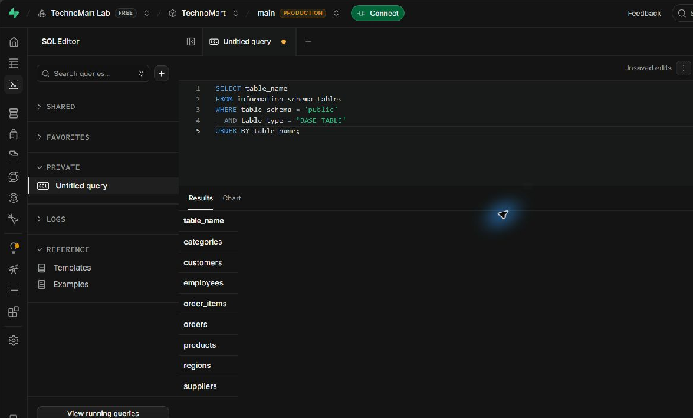

### Рівень 1. Базові вибірки

### 1.01. Отримати всі записи з таблиці customers.

```sql
-- Повний огляд довідника клієнтів.
SELECT *
FROM customers ORDER BY customer_id;
```

Результат: Отримано 15 записів клієнтів, включаючи фізичних осіб і юридичних осіб з різних міст України.

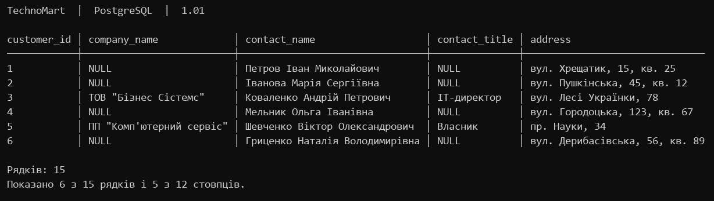

### 1.02. Назви та ціни

```sql
-- Сформувати прайс-лист без складських відомостей.
SELECT product_name, unit_price
FROM products ORDER BY product_id;
```

Результат: Кількість рядків у результаті: 25.

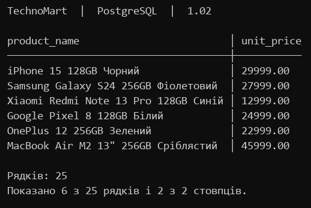

### 1.03. Контакти співробітників

```sql
-- Підготувати внутрішній телефонний довідник.
SELECT first_name, last_name, phone, email
FROM employees ORDER BY employee_id;
```

Результат: Кількість рядків у результаті: 8.

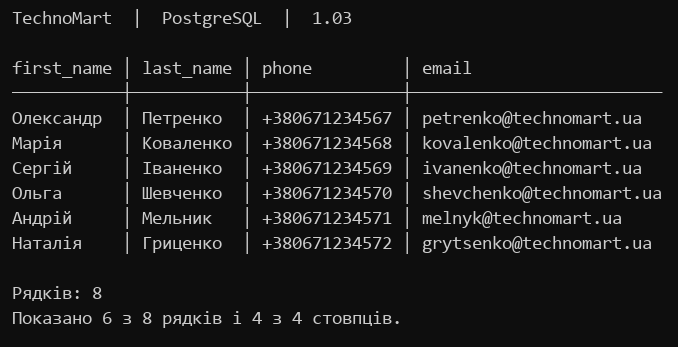

### 1.04. Клієнти Києва

```sql
-- Виділити клієнтів для міської кампанії.
SELECT *
FROM customers WHERE city = 'Київ' ORDER BY customer_id;
```

Результат: Кількість рядків у результаті: 4.

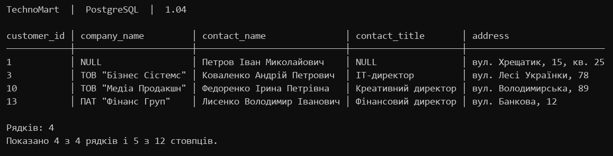

### 1.05. Ціна понад 25000 грн

```sql
-- Переглянути дорогі товари.
SELECT product_id, product_name, unit_price
FROM products WHERE unit_price > 25000 ORDER BY unit_price DESC, product_id;
```

Результат: Кількість рядків у результаті: 13.

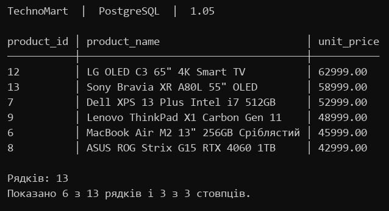

### 1.06. Доставлені замовлення

```sql
-- Переглянути завершені доставки.
SELECT *
FROM orders WHERE order_status = 'delivered' ORDER BY order_id;
```

Результат: Кількість рядків у результаті: 26.

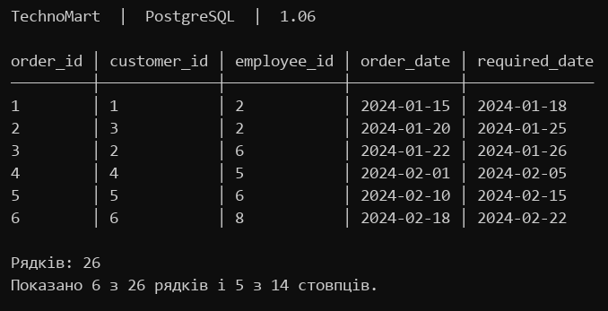

### 1.07. Працівники продажів

```sql
-- Знайти працівників за текстом посади.
SELECT employee_id, first_name, last_name, title
FROM employees WHERE title ILIKE '%продаж%' ORDER BY employee_id;
```

Результат: Кількість рядків у результаті: 3.

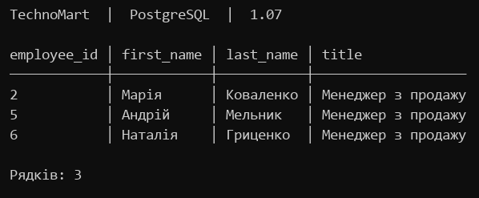

### 1.08. Товари від дешевих до дорогих

```sql
-- Показати асортимент за зростанням ціни.
SELECT product_id, product_name, unit_price
FROM products ORDER BY unit_price, product_id;
```

Результат: Кількість рядків у результаті: 25.

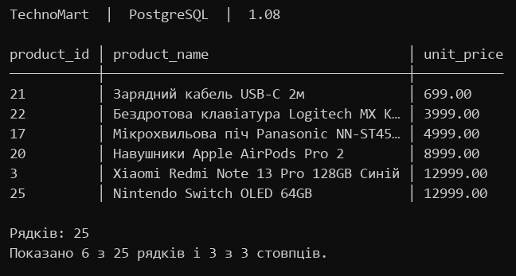

### 1.09. Контакти за алфавітом

```sql
-- Знайти людину в алфавітному списку.
SELECT customer_id, contact_name, city
FROM customers ORDER BY contact_name, customer_id;
```

Результат: Кількість рядків у результаті: 15.

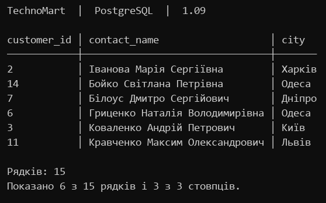

### 1.10. Замовлення за спаданням дати

```sql
-- Переглянути хронологію від найновіших записів.
SELECT order_id, order_date, order_status
FROM orders ORDER BY order_date DESC NULLS LAST, order_id DESC;
```

Результат: Кількість рядків у результаті: 31.

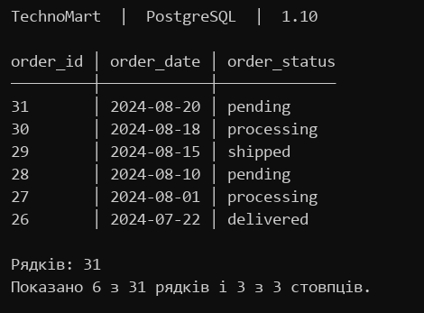

### 1.11. Десять найдорожчих товарів

```sql
-- Сформувати короткий перелік найдорожчих позицій.
SELECT product_name, unit_price
FROM products ORDER BY unit_price DESC, product_id LIMIT 10;
```

Результат: Отримано 10 товарів. Найвища ціна становить 62 999 грн.

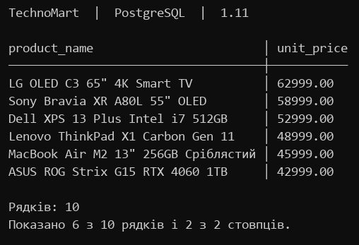

### 1.12. П’ять останніх замовлень

```sql
-- Переглянути нові замовлення для обробки.
SELECT order_id, order_date, order_status
FROM orders ORDER BY order_date DESC NULLS LAST, order_id DESC LIMIT 5;
```

Результат: Кількість рядків у результаті: 5.

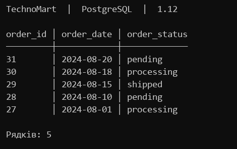

### 1.13. Вісім перших клієнтів за алфавітом

```sql
-- Показати початок алфавітного довідника.
SELECT customer_id, contact_name, city
FROM customers ORDER BY contact_name, customer_id LIMIT 8;
```

Результат: Кількість рядків у результаті: 8.

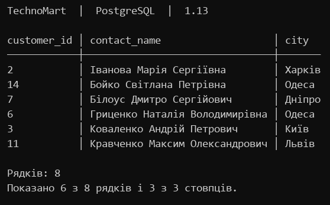

### Рівень 2. Фільтри та пагінація

### 2.01. Імена на Іван

```sql
-- Знайти контактні імена з потрібним початком.
SELECT contact_name, city
FROM customers WHERE contact_name LIKE 'Іван%' ORDER BY contact_name, customer_id;
```

Результат: Кількість рядків у результаті: 1.

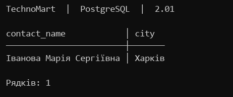

### 2.02. Телефони в назві товару

```sql
-- Зібрати назви, що містять англійський або український термін.
SELECT product_name, unit_price
FROM products WHERE product_name ILIKE '%phone%' OR product_name ILIKE '%телефон%' ORDER BY product_id;
```

Результат: Кількість рядків у результаті: 1.

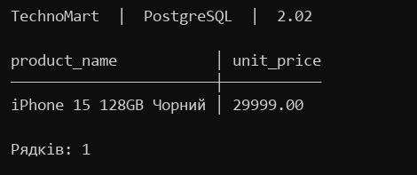

### 2.03. Назви на Samsung

```sql
-- Підібрати товари з брендом на початку назви.
SELECT product_name
FROM products WHERE product_name LIKE 'Samsung%' ORDER BY product_id;
```

Результат: Кількість рядків у результаті: 3.

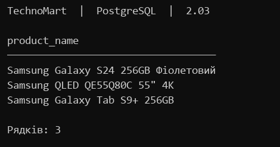

### 2.04. Пошта на gmail.com

```sql
-- Оцінити кількість контактів із поширеним поштовим доменом.
SELECT contact_name, email
FROM customers WHERE email ILIKE '%@gmail.com' ORDER BY customer_id;
```

Результат: Кількість рядків у результаті: 5.

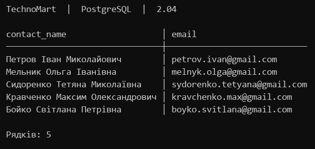

### 2.05. Товари з OLED

```sql
-- Знайти позиції з OLED у назві для тематичної добірки.
SELECT product_name, unit_price
FROM products WHERE product_name ILIKE '%OLED%' ORDER BY product_id;
```

Результат: Кількість рядків у результаті: 3.

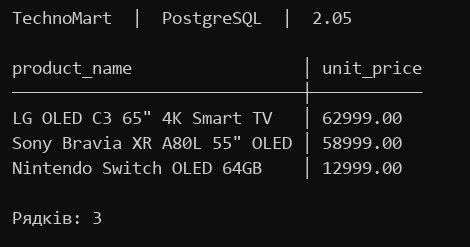

### 2.06. Ціна між 15000 і 50000 без меж

```sql
-- Відібрати товар у відкритому ціновому інтервалі.
SELECT product_name, unit_price
FROM products WHERE unit_price > 15000 AND unit_price < 50000 ORDER BY unit_price, product_id;
```

Результат: Кількість рядків у результаті: 16.

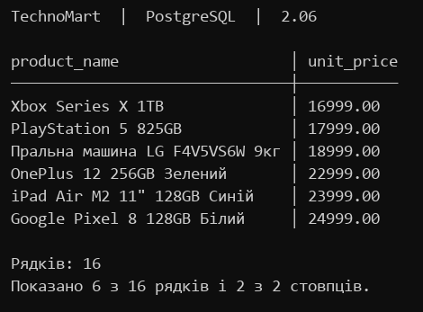

### 2.07. Компанії Києва і Львова

```sql
-- Скласти список корпоративних контактів у двох містах.
SELECT company_name, city, contact_name
FROM customers WHERE (city = 'Київ' OR city = 'Львів') AND customer_type = 'company' ORDER BY city, customer_id;
```

Результат: Кількість рядків у результаті: 3.

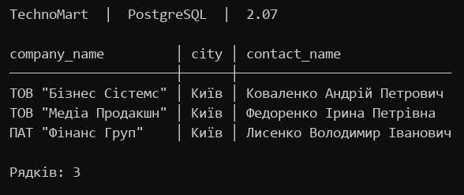

### 2.08. Активний товар за помірною ціною або з великим залишком

```sql
-- Знайти асортимент для кампанії з урахуванням доступності.
SELECT product_name, unit_price, units_in_stock
FROM products WHERE NOT discontinued AND (unit_price < 10000 OR units_in_stock >= 25) ORDER BY product_id;
```

Результат: Кількість рядків у результаті: 6.

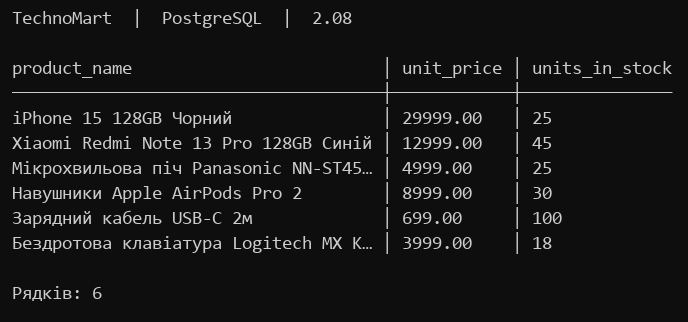

### 2.09. Регіональні контакти з каналом зв’язку

```sql
-- Знайти клієнтів поза Києвом, доступних за телефоном або поштою.
SELECT contact_name, city
FROM customers WHERE NOT (city = 'Київ') AND (phone IS NOT NULL OR email IS NOT NULL) ORDER BY customer_id;
```

Результат: Кількість рядків у результаті: 11.

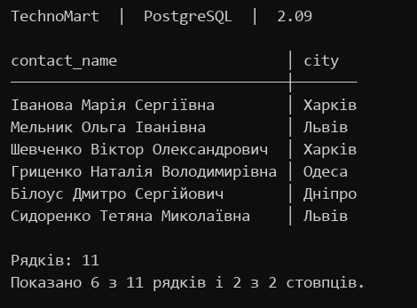

### 2.10. Черга логістики

```sql
-- Перевірити замовлення в роботі або відправлені без дати відправлення.
SELECT order_id, order_status, shipped_date
FROM orders WHERE (order_status = 'pending' OR order_status = 'processing') OR (order_status = 'shipped' AND shipped_date IS NULL) ORDER BY order_id;
```

Результат: Кількість рядків у результаті: 4.

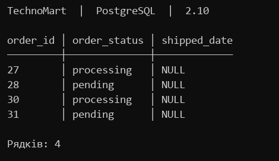

### 2.11. Посади з контактним email

```sql
-- Знайти контактних менеджерів та керівників без включення директора.
SELECT first_name, last_name, title
FROM employees WHERE (title ILIKE '%менеджер%' OR title ILIKE '%керівник%') AND NOT (title ILIKE '%директор%') AND email IS NOT NULL ORDER BY employee_id;
```

Результат: Кількість рядків у результаті: 5.

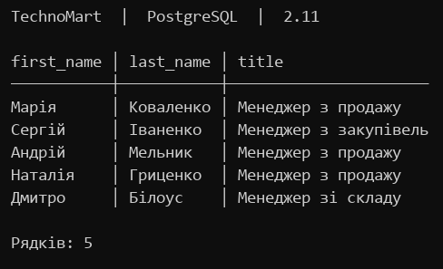

### 2.12. Чотири міста

```sql
-- Відібрати клієнтів для регіональної кампанії.
SELECT contact_name, city
FROM customers WHERE city IN ('Київ', 'Харків', 'Одеса', 'Дніпро') ORDER BY city, customer_id;
```

Результат: Кількість рядків у результаті: 12.

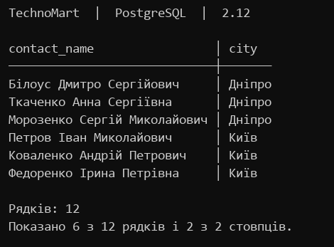

### 2.13. Ціновий інтервал 10000–30000

```sql
-- Підібрати позиції в бюджеті з обома включеними межами.
SELECT product_name, unit_price
FROM products WHERE unit_price BETWEEN 10000 AND 30000 ORDER BY unit_price, product_id;
```

Результат: Кількість рядків у результаті: 13.

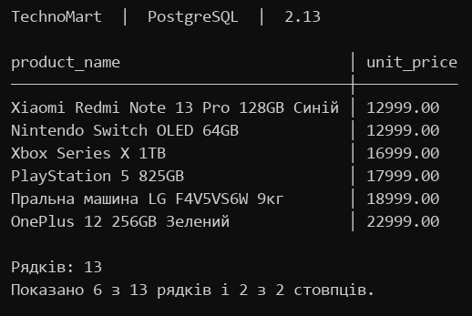

### 2.14. Категорії 1, 2 і 7

```sql
-- Зібрати персональні електронні пристрої за кодами категорій.
SELECT product_name, category_id
FROM products WHERE category_id IN (1, 2, 7) ORDER BY category_id, product_id;
```

Результат: Кількість рядків у результаті: 12.

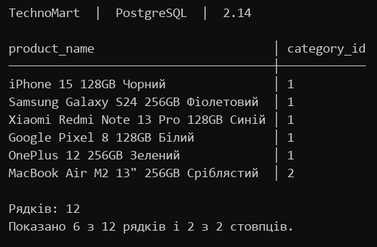

### 2.15. Відправлені та доставлені замовлення

```sql
-- Відібрати замовлення, що вже передано в доставку.
SELECT order_id, order_status
FROM orders WHERE order_status IN ('shipped', 'delivered') ORDER BY order_id;
```

Результат: Кількість рядків у результаті: 27.

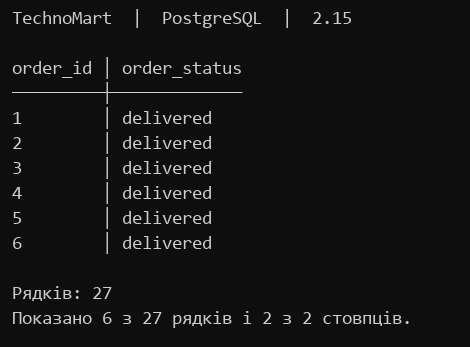

### 2.16. Замовлення першого кварталу

```sql
-- Відокремити замовлення за січень–березень 2024 року.
SELECT order_id, order_date
FROM orders WHERE order_date BETWEEN DATE '2024-01-01' AND DATE '2024-03-31' ORDER BY order_date, order_id;
```

Результат: Кількість рядків у результаті: 11.

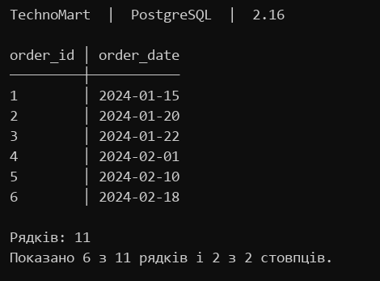

### 2.17. Невеликий складський залишок

```sql
-- Позначити товари, для яких на складі від трьох до десяти одиниць.
SELECT product_name, units_in_stock
FROM products WHERE units_in_stock BETWEEN 3 AND 10 ORDER BY units_in_stock, product_id;
```

Результат: Кількість рядків у результаті: 10.

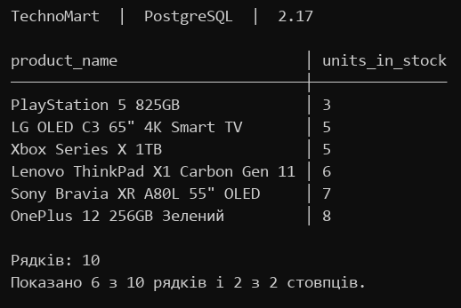

### 2.18. Клієнти без назви компанії

```sql
-- Виявити записи, де поле юридичної назви порожнє.
SELECT contact_name, customer_type
FROM customers WHERE company_name IS NULL ORDER BY customer_id;
```

Результат: Кількість рядків у результаті: 9.

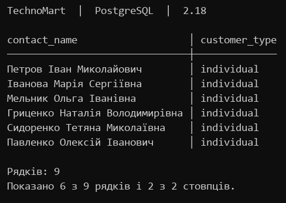

### 2.19. Призначений керівник

```sql
-- Отримати працівників, які мають безпосереднього керівника.
SELECT first_name, last_name, reports_to
FROM employees WHERE reports_to IS NOT NULL ORDER BY reports_to, employee_id;
```

Результат: Кількість рядків у результаті: 7.

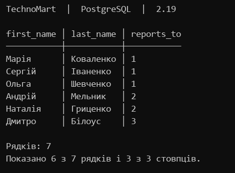

### 2.20. Добірка смартфонів

```sql
-- Підібрати брендовані смартфони в бюджеті й з наявністю.
SELECT product_name, unit_price, units_in_stock
FROM products WHERE (product_name ILIKE '%galaxy%' OR product_name ILIKE '%iphone%') AND category_id = 1 AND units_in_stock > 0 AND unit_price BETWEEN 20000 AND 35000 ORDER BY unit_price, product_id;
```

Результат: Кількість рядків у результаті: 2.

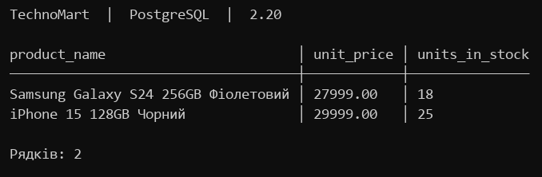

### 2.21. Замовлення двох міст у першому півріччі

```sql
-- Звузити логістичний зріз за містом і датою.
SELECT order_id, ship_city, order_date
FROM orders WHERE ship_city IN ('Київ', 'Одеса') AND order_date BETWEEN DATE '2024-01-01' AND DATE '2024-06-30' AND order_status <> 'cancelled' ORDER BY order_date, order_id;
```

Результат: Кількість рядків у результаті: 9.

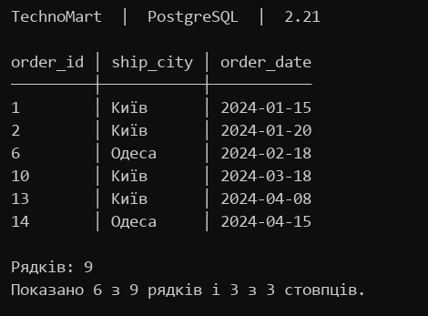

### 2.22. B2B-контакти з офісною тематикою

```sql
-- Підібрати компанії, назви яких вказують на офіс або бізнес.
SELECT company_name, city
FROM customers WHERE customer_type = 'company' AND email IS NOT NULL AND (company_name ILIKE '%офіс%' OR company_name ILIKE '%бізнес%') ORDER BY customer_id;
```

Результат: Кількість рядків у результаті: 2.

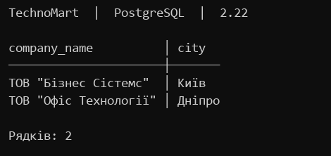

### 2.23. Постачання для активного каталогу

```sql
-- Знайти активні позиції в певних категоріях з малим або поповнюваним залишком.
SELECT product_name, units_in_stock, units_on_order
FROM products WHERE category_id IN (1, 2, 6) AND NOT discontinued AND (units_in_stock BETWEEN 0 AND 8 OR units_on_order >= 10) ORDER BY units_in_stock, product_id;
```

Результат: Кількість рядків у результаті: 8.

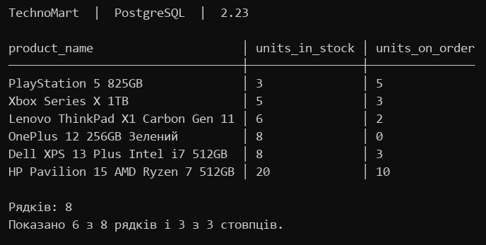

### 2.24. Доставки з відомою датою

```sql
-- Зібрати завершені доставки за обраними перевізниками та в межах витрат.
SELECT order_id, ship_via, freight
FROM orders WHERE order_status = 'delivered' AND shipped_date IS NOT NULL AND ship_via IN ('Нова Пошта', 'УкрПошта') AND freight BETWEEN 80 AND 200 ORDER BY freight, order_id;
```

Результат: Кількість рядків у результаті: 11.

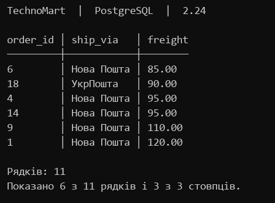

### 2.25. Каталог за категорією і ціною

```sql
-- Відсортувати позиції в межах категорії від найдорожчої.
SELECT category_id, product_name, unit_price
FROM products ORDER BY category_id NULLS LAST, unit_price DESC, product_id;
```

Результат: Кількість рядків у результаті: 25.

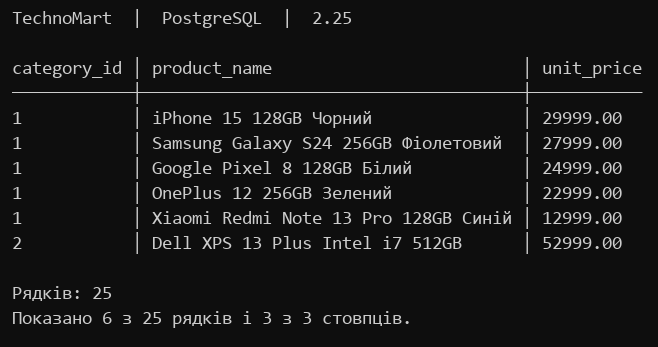

### 2.26. Клієнти за містом і типом

```sql
-- Згрупувати вивід за містом, типом та контактною особою.
SELECT city, customer_type, contact_name
FROM customers ORDER BY city NULLS LAST, customer_type NULLS LAST, contact_name, customer_id;
```

Результат: Кількість рядків у результаті: 15.

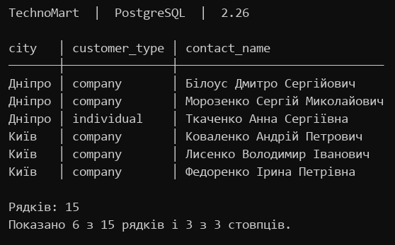

### 2.27. Черга відправлення

```sql
-- Впорядкувати відкриті замовлення за дедлайном, вартістю доставки та ID.
SELECT order_id, required_date, freight
FROM orders WHERE order_status IN ('pending', 'processing') ORDER BY required_date NULLS LAST, freight DESC NULLS LAST, order_id;
```

Результат: Кількість рядків у результаті: 4.

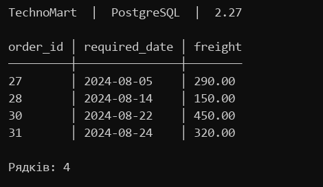

### 2.28. Перша сторінка каталогу

```sql
-- Показати перші десять позицій стабільного списку.
SELECT product_id, product_name
FROM products ORDER BY product_name, product_id LIMIT 10 OFFSET 0;
```

Результат: Кількість рядків у результаті: 10.

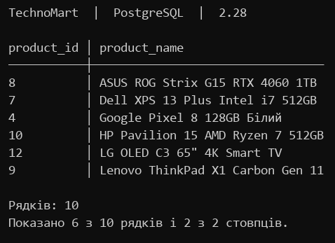

### 2.29. Друга сторінка каталогу

```sql
-- Пропустити першу десятку без перетину за незмінних даних.
SELECT product_id, product_name
FROM products ORDER BY product_name, product_id LIMIT 10 OFFSET 10;
```

Результат: Кількість рядків у результаті: 10.

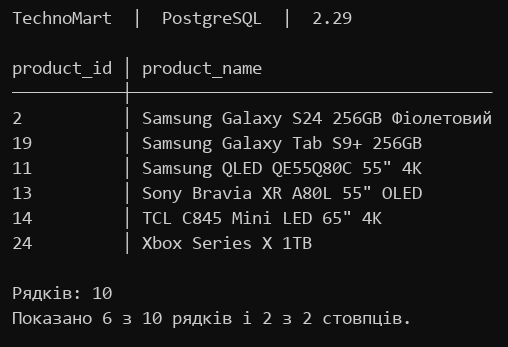

### Рівень 3. Аналітичні запити

### 3.01. Samsung або Apple без чохлів

```sql
-- Знайти бренди в назві та виключити чохли.
SELECT product_name, unit_price
FROM products WHERE (product_name ILIKE '%Samsung%' OR product_name ILIKE '%Apple%') AND product_name NOT ILIKE '%чохол%' ORDER BY product_id;
```

Результат: Кількість рядків у результаті: 5.

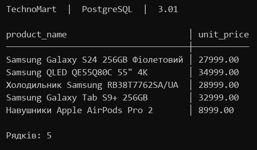

### 3.02. Телевізори без офісних пристроїв

```sql
-- Виділити телевізійну техніку за характеристикою або виробником.
SELECT product_name
FROM products WHERE (product_name ILIKE '%OLED%' OR product_name ILIKE '%QLED%') AND product_name NOT ILIKE '%switch%' AND category_id = 3 ORDER BY product_id;
```

Результат: Кількість рядків у результаті: 3.

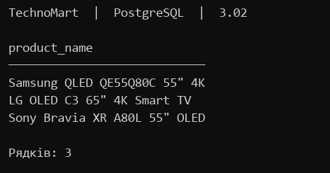

### 3.03. Портативні ноутбуки

```sql
-- Знайти ноутбуки для мобільної роботи за назвою моделі.
SELECT product_name, unit_price
FROM products WHERE (product_name ILIKE '%thinkpad%' OR product_name ILIKE '%macbook%') AND NOT (product_name ILIKE '%rog%' OR product_name ILIKE '%gaming%') ORDER BY product_id;
```

Результат: Кількість рядків у результаті: 2.

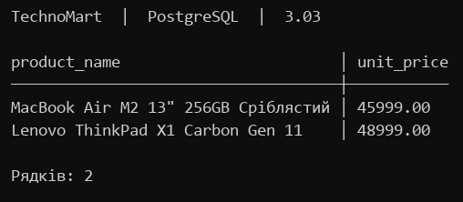

### 3.04. Ігровий асортимент без Nintendo

```sql
-- Порівняти пропозиції двох платформ для добірки ігрових консолей.
SELECT product_name, units_in_stock
FROM products WHERE (product_name ILIKE 'PlayStation%' OR product_name ILIKE 'Xbox%') AND product_name NOT ILIKE '%Nintendo%' ORDER BY product_id;
```

Результат: Кількість рядків у результаті: 2.

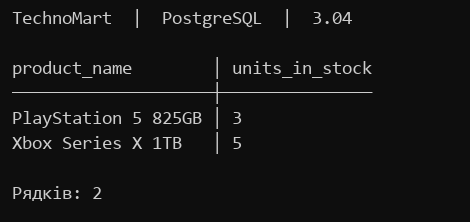

### 3.05. Логістика для Києва

```sql
-- Переглянути київські відправлення двох поштових операторів без скасованих.
SELECT order_id, ship_via, order_status
FROM orders WHERE ship_city ILIKE 'київ' AND (ship_via ILIKE 'нова%' OR ship_via ILIKE 'укр%') AND order_status NOT ILIKE 'cancel%' ORDER BY order_id;
```

Результат: Кількість рядків у результаті: 5.

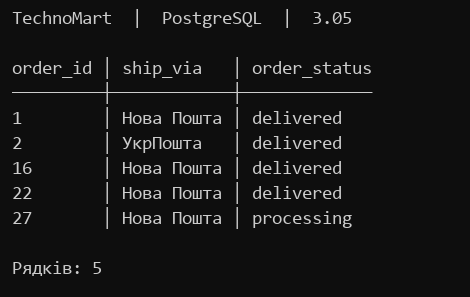

### 3.06. Дорогі у двох категоріях або дешеві

```sql
-- Зібрати дорогі телефони й комп’ютери та дешеві товари всіх категорій.
SELECT category_id, product_name, unit_price
FROM products WHERE (unit_price > 20000 AND category_id IN (1, 2)) OR unit_price < 5000 ORDER BY unit_price, product_id;
```

Результат: Кількість рядків у результаті: 12.

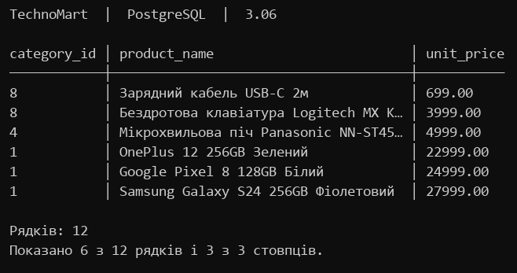

### 3.07. Складські винятки

```sql
-- Знайти активні позиції з ризиком нестачі або з підтвердженим поповненням дорогого асортименту.
SELECT product_name, units_in_stock, units_on_order
FROM products WHERE NOT discontinued AND ((units_in_stock <= reorder_level AND COALESCE(units_on_order, 0) = 0) OR (unit_price >= 40000 AND units_on_order > 0 AND (category_id = 2 OR category_id = 3))) ORDER BY product_id;
```

Результат: Кількість рядків у результаті: 6.

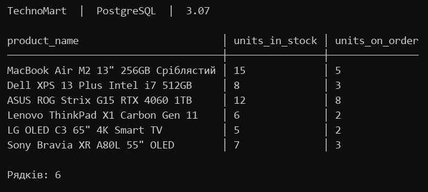

### 3.08. Пріоритети корпоративної кампанії

```sql
-- Підібрати компанії у ключових містах або інші контакти, зареєстровані протягом кампанії.
SELECT contact_name, city, customer_type
FROM customers WHERE email IS NOT NULL AND ((customer_type = 'company' AND (city = 'Київ' OR city = 'Львів')) OR (customer_type = 'individual' AND city = 'Одеса' AND registration_date BETWEEN DATE '2024-01-01' AND DATE '2024-12-31')) ORDER BY city, customer_id;
```

Результат: Кількість рядків у результаті: 3.


### 3.09. Контроль доставки

```sql
-- Знайти активні замовлення без відправлення або доставлені з високою вартістю для ключових міст.
SELECT order_id, ship_city, order_status, freight
FROM orders WHERE ((order_status IN ('pending', 'processing') AND (shipped_date IS NULL OR shipped_date > required_date)) OR (order_status = 'delivered' AND freight >= 200 AND ship_city IN ('Київ', 'Дніпро'))) ORDER BY order_id;
```

Результат: Кількість рядків у результаті: 9.


### 3.10. Звіт товарів для промокампанії

```sql
-- Одночасно перевірити ціну, категорію, наявність, статус, опис, назву та поріг поповнення.
SELECT product_id, product_name, unit_price, units_in_stock, reorder_level
FROM products WHERE unit_price BETWEEN 10000 AND 50000 AND category_id IN (1, 2, 3, 7) AND units_in_stock >= 8 AND discontinued IS FALSE AND description IS NOT NULL AND product_name NOT ILIKE '%чохол%' AND units_in_stock > reorder_level ORDER BY unit_price DESC, product_id;
```

Результат: Кількість рядків у результаті: 12.


### 3.11. Сегментація клієнтської бази

```sql
-- Розподілити зв’язувані контакти на цільові групи за типом, географією та повнотою картки.
SELECT customer_id, contact_name, city, customer_type, CASE WHEN customer_type = 'company' AND city = 'Київ' THEN 'Київський B2B' WHEN customer_type = 'company' THEN 'Регіональний B2B' ELSE 'Роздріб' END AS segment
FROM customers WHERE city IN ('Київ','Львів','Харків','Одеса','Дніпро') AND email IS NOT NULL AND contact_name NOT ILIKE '%тест%' AND ((customer_type = 'company' AND company_name IS NOT NULL) OR (customer_type = 'individual' AND phone IS NOT NULL)) ORDER BY segment, city, customer_id;
```

Результат: Кількість рядків у результаті: 15.


### 3.12. Розподіл за ціновими сегментами

```sql
-- Порівняти кількість і середню ціну товарів у взаємовиключних сегментах.
WITH price_segments AS (SELECT unit_price, CASE WHEN unit_price < 5000 THEN 1 WHEN unit_price < 20000 THEN 2 WHEN unit_price < 50000 THEN 3 ELSE 4 END AS band
FROM products) SELECT band, (ARRAY['до 5000','5000–19999,99','20000–49999,99','від 50000'])[band] AS segment, COUNT(*) AS products, ROUND(AVG(unit_price), 2) AS avg_price FROM price_segments GROUP BY band ORDER BY band;
```

Результат: Отримано 4 цінові сегменти, які разом охоплюють 25 товарів.


### 3.13. Наявність у бюджетному сегменті

```sql
-- Знайти доступні бюджетні позиції для негайного продажу.
SELECT product_name, unit_price, units_in_stock
FROM products WHERE unit_price < 5000 AND units_in_stock > 0 AND discontinued IS FALSE ORDER BY unit_price, product_id;
```

Результат: Кількість рядків у результаті: 3.


### 3.14. Капітал у преміальних запасах

```sql
-- Порівняти вартість залишків преміальних позицій між категоріями.
SELECT c.category_name, COUNT(*) AS products, SUM(p.unit_price * p.units_in_stock) AS inventory_value
FROM products AS p JOIN categories AS c USING (category_id) WHERE p.unit_price >= 20000 AND p.units_in_stock > 0 GROUP BY c.category_id, c.category_name ORDER BY inventory_value DESC, c.category_id;
```

Результат: Кількість рядків у результаті: 5.


### 3.15. Концентрація клієнтів за містами

```sql
-- Визначити міста з найбільшими частками клієнтської бази.
SELECT COALESCE(city, 'Не вказано') AS city, COUNT(*) AS customers, ROUND(100.0 * COUNT(*) / SUM(COUNT(*)) OVER (), 2) AS share_pct
FROM customers GROUP BY city ORDER BY customers DESC, city;
```

Результат: Отримано 5 міст. Київ має найбільшу частку: 4 клієнти з 15, або 26,67%.


### 3.16. Покриття областей

```sql
-- Знайти області з малою або нульовою клієнтською присутністю.
SELECT r.region_name, COUNT(c.customer_id) AS customers
FROM regions AS r LEFT JOIN customers AS c USING (region_id) GROUP BY r.region_id, r.region_name ORDER BY customers, r.region_id;
```

Результат: Кількість рядків у результаті: 25.


### 3.17. Корпоративна частка по містах

```sql
-- Визначити міста з найвищою часткою юридичних осіб серед міст із двома клієнтами або більше.
SELECT city, COUNT(*) AS customers, COUNT(*) FILTER (WHERE customer_type = 'company') AS b2b, ROUND(100.0 * COUNT(*) FILTER (WHERE customer_type = 'company') / COUNT(*), 2) AS b2b_pct
FROM customers WHERE city IS NOT NULL GROUP BY city HAVING COUNT(*) >= 2 ORDER BY b2b_pct DESC, customers DESC, city;
```

Результат: Кількість рядків у результаті: 5.


### 3.18. Географія першого замовлення

```sql
-- Зіставити місто у профілі та місто доставки першого замовлення.
WITH first_order AS (SELECT DISTINCT ON (customer_id) customer_id, ship_city
FROM orders WHERE customer_id IS NOT NULL AND order_date IS NOT NULL ORDER BY customer_id, order_date, order_id) SELECT c.customer_id, c.city, f.ship_city FROM customers AS c JOIN first_order AS f USING (customer_id) WHERE c.city IS NOT NULL AND f.ship_city IS NOT NULL AND c.city <> f.ship_city ORDER BY c.customer_id;
```

Результат: Отримано 0 рядків. Для клієнтів із відомими містами у профілі й у першому замовленні розбіжностей немає.


### 3.19. Замовлення за місяцями

```sql
-- Порівняти щомісячний попит і відокремити доставлені замовлення.
SELECT DATE_TRUNC('month', order_date)::date AS month, COUNT(*) AS orders, COUNT(*) FILTER (WHERE order_status = 'delivered') AS delivered
FROM orders WHERE order_date IS NOT NULL GROUP BY 1 ORDER BY 1;
```

Результат: Кількість рядків у результаті: 8.


### 3.20. Замовлення за днями тижня

```sql
-- Оцінити навантаження на обробку замовлень за днями тижня від понеділка до неділі.
WITH weekdays AS (SELECT generate_series(1, 7) AS iso_day), counts AS (SELECT EXTRACT(ISODOW
FROM order_date)::int AS iso_day, COUNT(*) AS orders FROM orders WHERE order_date IS NOT NULL GROUP BY 1) SELECT w.iso_day, (ARRAY['Пн','Вт','Ср','Чт','Пт','Сб','Нд'])[w.iso_day] AS weekday, COALESCE(c.orders, 0) AS orders FROM weekdays AS w LEFT JOIN counts AS c USING (iso_day) ORDER BY w.iso_day;
```

Результат: Отримано 7 днів тижня. Найбільшу кількість замовлень зафіксовано в понеділок: 11.


### 3.21. Термін відправлення за місяцями

```sql
-- Порівняти середнє очікування відправлення та частоту відправок після необхідної дати.
SELECT DATE_TRUNC('month', order_date)::date AS month, COUNT(*) AS shipped_orders, ROUND(AVG(shipped_date - order_date), 2) AS avg_days, COUNT(*) FILTER (WHERE shipped_date > required_date) AS shipped_late
FROM orders WHERE shipped_date IS NOT NULL AND order_date IS NOT NULL GROUP BY 1 ORDER BY 1;
```

Результат: Кількість рядків у результаті: 8.


### 3.22. Повторні покупки після доставки

```sql
-- Виявити клієнтів із повторними доставленими замовленнями й оцінити паузу між першою та останньою покупками.
SELECT c.customer_id, c.contact_name, COUNT(*) AS delivered_orders, MAX(o.order_date) - MIN(o.order_date) AS span_days
FROM customers AS c JOIN orders AS o USING (customer_id) WHERE o.order_status = 'delivered' AND o.order_date IS NOT NULL GROUP BY c.customer_id HAVING COUNT(*) >= 2 ORDER BY delivered_orders DESC, span_days DESC, c.customer_id;
```

Результат: Кількість рядків у результаті: 11.


### 3.23. Товарні пари в доставлених кошиках

```sql
-- Знайти найпоширеніші комбінації для перехресних продажів.
SELECT p.product_name AS product_a, q.product_name AS product_b, COUNT(*) AS baskets
FROM order_items AS a JOIN order_items AS b ON a.order_id = b.order_id AND a.product_id < b.product_id JOIN orders AS o ON o.order_id = a.order_id JOIN products AS p ON p.product_id = a.product_id JOIN products AS q ON q.product_id = b.product_id WHERE o.order_status = 'delivered' GROUP BY p.product_id, q.product_id ORDER BY baskets DESC, p.product_id, q.product_id LIMIT 10;
```

Результат: Кількість рядків у результаті: 10.


### 3.24. Рейтинг товарів усередині категорій

```sql
-- Знайти дві найдорожчі позиції кожної категорії для порівняльної вітрини.
WITH ranked AS (SELECT category_id, product_id, product_name, unit_price, ROW_NUMBER() OVER (PARTITION BY category_id
ORDER BY unit_price DESC, product_id) AS position FROM products WHERE category_id IS NOT NULL) SELECT category_id, product_name, unit_price, position FROM ranked WHERE position <= 2 ORDER BY category_id, position;
```

Результат: Кількість рядків у результаті: 14.


### 3.25. Кандидати на перегляд асортименту

```sql
-- Знайти наявні товари без жодного рядка в доставлених замовленнях.
SELECT p.product_id, p.product_name, p.units_in_stock
FROM products AS p WHERE p.units_in_stock > 0 AND p.discontinued IS FALSE AND NOT EXISTS (SELECT 1 FROM order_items AS i JOIN orders AS o USING (order_id) WHERE i.product_id = p.product_id AND o.order_status = 'delivered') ORDER BY p.units_in_stock DESC, p.product_id;
```

Результат: Кількість рядків у результаті: 4.


### 3.26. Частка витрат на доставку

```sql
-- Знайти доставлені замовлення, у яких доставка складає 5% або більше від вартості товарів після знижок.
WITH basket AS (SELECT order_id, SUM(unit_price * quantity * (1 - COALESCE(discount, 0))) AS net_value
FROM order_items GROUP BY order_id) SELECT o.order_id, ROUND(b.net_value, 2) AS net_value, o.freight, ROUND(100 * o.freight / NULLIF(b.net_value, 0), 2) AS freight_pct FROM orders AS o JOIN basket AS b USING (order_id) WHERE o.order_status = 'delivered' AND b.net_value > 0 AND o.freight >= b.net_value * 0.05 ORDER BY freight_pct DESC, o.order_id;
```

Результат: Отримано 0 рядків. У доставлених замовленнях із додатною вартістю кошика частка доставки менша за 5%.


## Висновки

**Самооцінка:** 5

**Обґрунтування:** виконано всі завдання трьох рівнів. Усі 68 запитів виконано у Supabase на базі TechnoMart. Пакетна перевірка показала 0 розбіжностей за кількістю рядків відносно локального запуску. Для кожного запиту наведено код, мету й результат. Підсумки за ціновими сегментами, містами та днями тижня узгоджуються з кількістю записів у вихідних таблицях.
